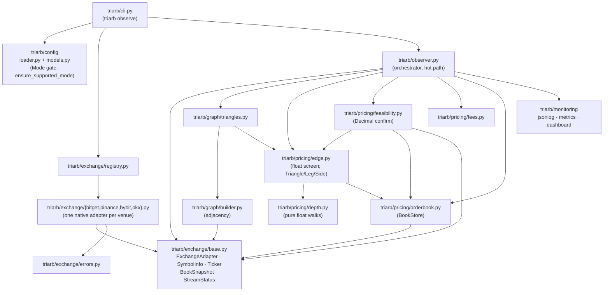

# ARCHITECTURE.md — system architecture (Phase 1: MARKET_DATA_ONLY)

> Status: this build is an **observer**. It streams public market data,
> prices triangles, and logs cycles. It contains **no order, balance,
> withdrawal, or transfer code of any kind**. Every claim below is labeled
> **Implemented** (true of the code today, with a file reference) or
> **Planned** (required by the master prompt in `CLAUDE.md` Part B, cited by
> section). Nothing here asserts profitability or production readiness — see
> the README's economics section for why most detected cycles are not
> tradeable.

## 1. The §7 logical flow mapped onto this codebase

The master prompt (`CLAUDE.md` §7) defines a thirteen-stage logical flow.
This table is the authoritative map of which stages exist today.

| §7 stage | Status | Where |
|---|---|---|
| Exchange Public WebSockets | **Implemented** (all four venues) | `stream_books` in `triarb/exchange/bitget.py`, `binance.py`, `bybit.py`, `okx.py`; wired in `registry.py`. Binance/Bybit/OKX are offline-fixture-verified, live soak pending (`PROGRESS.md`) |
| Normalized Market Events | **Implemented** | `BookSnapshot` + `StreamStatus` in `triarb/exchange/base.py`; venue frames are parsed in the adapter, never downstream |
| Local Order-Book Engine | **Implemented** (snapshot-replace variant) | `triarb/pricing/orderbook.py` (`Book`, `BookStore`). Full §13 sequence/checksum incremental handling is **Planned** (`CLAUDE.md` §13; `docs/ORDER_BOOK_ENGINE.md`, decision D-002) |
| Currency Graph | **Implemented** | `triarb/graph/builder.py` (`build_adjacency`: currencies are nodes, each spot market is both directed edges) |
| Triangle Discovery | **Implemented** | `triarb/graph/triangles.py` (`enumerate_cycles`, `compile_triangle`, `build_triangles` with volume/spread filters, ranking, cap, whitelist mode) |
| Depth-Aware Opportunity Simulation | **Implemented** | `triarb/pricing/depth.py` (walks), `triarb/pricing/edge.py` (float screen), `triarb/pricing/feasibility.py` (exact Decimal confirm) |
| Profitability Gate | **Partial** — see below | Threshold + staleness + depth + rounding feasibility exist (`triarb/observer.py`, `triarb/pricing/edge.py`, `feasibility.py`). The full §15 gate list is **Planned** (`CLAUDE.md` §15) |
| Central Risk Engine | **Planned** | `CLAUDE.md` §23; future `risk/` package (README "Planned for later phases") |
| Execution Planner | **Planned** | `CLAUDE.md` §16–§18; future `execution/` package |
| Exchange Adapter (trading surface) | Market-data surface **Implemented**; trading surface **Planned** | `triarb/exchange/base.py` today; §8 surface per `docs/EXCHANGE_ADAPTER_CONTRACT.md` |
| Private Order and Fill Streams | **Planned** | `CLAUDE.md` §8 (`subscribeOrders`, `subscribeExecutions`, `subscribeBalances`); no API keys are read anywhere in this build |
| Reconciliation and Recovery | **Planned** | `CLAUDE.md` §21; `docs/RECOVERY_ENGINE.md` |
| Profit and Audit Ledger | **Planned** | `CLAUDE.md` §27 and §7; future `accounting/` package |

Two §7 interface rules already hold structurally today:

- *"The opportunity detector must never call an exchange trading endpoint
  directly."* — **Implemented** trivially and verifiably: no trading endpoint
  exists in the codebase. The observer's only adapter calls are
  `fetch_symbols`, `fetch_tickers`, `stream_books`, `aclose`
  (`triarb/observer.py`).
- *"The execution engine must never bypass the central risk engine."* —
  **Planned** (`CLAUDE.md` §7, §23); neither component exists yet.

### What today's "profitability gate" is and is not

**Implemented** checks, in evaluation order (`triarb/observer.py::_evaluate`,
`triarb/pricing/edge.py::evaluate_cycle`,
`triarb/pricing/feasibility.py::simulate_rounded_cycle`):

1. All three leg books present (`missing_book` reject).
2. All three leg books fresh — age measured from the local monotonic clock,
   bound `observer.staleness_ms` (`stale_book` reject).
3. Visible depth absorbs the full notional on every leg
   (`insufficient_depth` reject; walks never extrapolate past the last level).
4. Net edge after compounded per-leg taker fees ≥
   `observer.edge_threshold_bps`.
5. Exact-Decimal rounding feasibility: lot steps, price precision,
   `min_base_amount`, `min_notional`, dust accounting
   (`qty_rounds_to_zero` / `min_qty` / `min_notional` rejects).

**Planned** (`CLAUDE.md` §15): the remaining named gates — "Balances
sufficient", "Risk limits satisfied", "Expected profit above uncertainty
reserve", "Exchange API healthy", "Private order stream healthy", "No
unresolved reconciliation error", "No active kill switch" — and the §15
threshold set (`MIN_EXPECTED_NET_PROFIT_BPS`, `LATENCY_RESERVE_BPS`,
`FAILURE_RESERVE_BPS`, `MAX_BOOK_SKEW_MS`, `MAX_SLIPPAGE_BPS`,
`MAX_CYCLE_NOTIONAL`, …). Note in particular: cross-book timestamp-skew
rejection (§13/§15 "Timestamp skew acceptable") is **Planned**; today each
book is only individually age-checked, and `max_book_age_ms` is logged on
every detection for honest post-analysis.

## 2. Module dependency graph (Implemented modules only)



Notes on the arrows (**Implemented**):

- `graph/triangles.py` imports `Triangle`/`Leg`/`Side` *from*
  `pricing/edge.py` — discovery compiles directly into the hot-path
  representation, so there is no translation layer between discovery and
  pricing.
- `pricing/depth.py` is pure functions over `list[tuple[float, float]]`
  with no project imports — the innermost hot-path code has zero coupling.
- Adapters are reached only through `create_adapter(venue)`
  (`triarb/exchange/registry.py`); adding a venue touches one adapter module
  plus one registry line.

**Planned** packages (deliberately absent today; README "Planned for later
phases", `CLAUDE.md` §16–§27): `execution/` (IOC leg sequencer + unwind
state machine with the §18 states `DETECTED` … `MANUAL_INTERVENTION`),
`risk/` (central risk engine + §24 kill switches), `accounting/` (per-cycle
PnL, reconciliation, ledger).

## 3. The modular-monolith decision

**Implemented.** The master prompt instructs: *"Do not introduce unnecessary
microservices during the first milestone. Begin with a modular monolith
unless scaling evidence requires separation"* (`CLAUDE.md` §5). This build
is a single asyncio process with package-level seams (`exchange/`, `graph/`,
`pricing/`, `monitoring/`, `config/`) exactly where §7 stage boundaries fall,
so later stages attach without moving existing code.

Two recorded refinements (`docs/DECISIONS.md`):

- **D-004 — one venue per process.** Exchange independence (§1 of the master
  prompt: own balances, books, limits, state) is achieved by running one
  process per venue with its own config (`Settings.venue`,
  `triarb/config/models.py`); no cross-venue state exists, and cross-exchange
  transfer logic is banned permanently.
- **D-001 — preserve the Python stack.** §5 recommends Rust *for greenfield*
  but instructs preserving a sound existing stack; the tested Python
  observer was kept, with revisit criteria tied to measured latency.

There is no database, message broker, or IPC in this build
(**Implemented** absence): the JSON-lines log
(`triarb/monitoring/jsonlog.py`) is the only durable output. Persistence
(PostgreSQL per §5, persisted state machine per §18) is **Planned** and
arrives with execution phases.

## 4. Hot-path data flow: float screen → Decimal confirm

The money rule (`CLAUDE.md` Part A; Invariant 21, §31): **binary floats are
never authoritative for money.** The hot path is a float *screen*; anything
reported as actionable carries an exact-`Decimal` re-simulation.

Per book update (**Implemented**, `triarb/observer.py`):

```text
WS frame (venue task)                          triarb/exchange/<venue>.py
  → parse to BookSnapshot | StreamStatus         parse_ws_message()
  → Observer._consume dispatches
      StreamStatus  → mark ALL books stale on DISCONNECTED,
                      end every active opportunity (ws_disconnect)
      BookSnapshot  → Observer._on_book:
        1. BookStore.apply(snap)   — verbatim replace, no merging   orderbook.py
        2. for each Triangle touching snap.symbol (by_symbol index):
           evaluate_cycle(...)     — FLOAT SCREEN                   edge.py
             · per leg: staleness check, depth walk, × (1 − fee)
             · returns EdgeResult(ok, reason, gross_bps, net_bps,
               max_age_ms, worst_prices)
        3. if ok and net_bps ≥ edge_threshold_bps:
           simulate_rounded_cycle(...) — DECIMAL CONFIRM            feasibility.py
             · simulates the three IOC limit orders Phase 2 would place
             · BUY: limit = worst ask rounded UP to price precision;
                    qty = spend/limit rounded DOWN to qty step
             · SELL: qty rounded DOWN; limit = worst bid rounded DOWN
             · fee charged in the received currency; dust stranded in
               non-quote currencies valued at ZERO (pessimistic);
               unspent leg-1 quote counted back in
             · rejects: missing_metadata, missing_book,
               insufficient_depth, qty_rounds_to_zero, min_qty, min_notional
        4. opportunity lifecycle: first eval at/above threshold logs
           cycle_detected (with net_after_rounding_bps, feasible,
           reject_reason, stranded_dust, max_book_age_ms); first eval
           below it logs cycle_ended (persisted_ms, peaks, ever_feasible)
        5. reprice_latency_us histogram observes elapsed time            metrics.py
```

Design constraints that keep the screen honest (**Implemented**):

- The float walk and the Decimal simulation read the *same* `BookStore`
  levels; neither averages, smooths, or extrapolates
  (`triarb/pricing/orderbook.py`, `depth.py`).
- Fees compound per leg on the received amount — the 3-leg hurdle is
  `1/(1−f)³ − 1`, not `3f` (`triarb/pricing/fees.py::hurdle_bps`,
  unit-tested in `tests/test_fees.py`).
- Staleness uses `time.perf_counter_ns()` receive stamps, so venue clock
  skew cannot hide a stalled feed (`triarb/pricing/orderbook.py::Book.age_ms`).
- A `rounding_killed` counter tracks float-positive cycles the Decimal pass
  rejected — the screen's false positives are measured, not hidden
  (`triarb/observer.py`, `triarb/monitoring/metrics.py`).

Background tasks beside the consumer (**Implemented**,
`triarb/observer.py::run` — asyncio `TaskGroup`, any crash is loud and fatal):
a 0.25 s sweeper closing opportunities whose leg books went stale between
updates; a periodic `stats` log; an optional symbol-metadata refresh that
warns on degraded symbols (Phase 1 does not rebuild the triangle universe
mid-run — restart to pick it up).

## 5. Mode gate

**Implemented** (`triarb/config/models.py`): `Mode` enum with the four §3
mode names — `MARKET_DATA_ONLY`, `PAPER_TRADING`, `SHADOW_TRADING`,
`LIVE_TRADING` — and `ensure_supported_mode()`, called by
`triarb/cli.py::_observe` before any network connection. Only
`MARKET_DATA_ONLY` starts. `LIVE_TRADING` is refused with a message naming
the §3 authorization chain; it can never be enabled by config alone. Test
evidence: `tests/test_config.py::TestModeGate` (Invariant 17).

## 6. TBDs (per CLAUDE.md §6)

| ID | Open question | Safest reversible assumption recorded |
|---|---|---|
| TBD-ARCH-1 | Where `SHADOW_TRADING` sits in the README phase plan (Phases 2–4 name paper, live-minimum-size, hardening; shadow is required by `CLAUDE.md` §3 before live but is not yet scheduled). | Shadow qualification must complete before any `LIVE_TRADING` activation regardless of phase numbering; nothing depends on the ordering today because the mode gate refuses both modes (`triarb/config/models.py`). |
| TBD-ARCH-2 | Exact per-leg `min_notional` valuation. Today `simulate_rounded_cycle` proxies each leg's USDT value with the starting notional × 0.95 haircut and skips the check entirely when the cycle's quote currency is not USDT (`triarb/pricing/feasibility.py`). | Conservative haircut proxy for USDT-quote cycles; the non-USDT skip is a documented model limit, and exact per-leg valuation lands with the Phase 2 executor, which will track conversion rates. |
| TBD-ARCH-3 | Persistence layer for the §18 state machine and §27 ledger (master prompt §5 recommends PostgreSQL). | No persistence is needed in MARKET_DATA_ONLY; the append-mode JSON-lines log is the only durable record today. The choice is deferred to the Phase 2 specification and recorded in `docs/DECISIONS.md` when made. |
| TBD-ARCH-4 | Cross-book timestamp-skew bound (`MAX_BOOK_SKEW_MS`, §13/§15). | Not enforced yet; every detection logs `max_book_age_ms` so analysis can discard skew-suspect detections after the fact. Enforcement ships with the full Profitability Gate. |

## 7. Related documents

- `docs/EXCHANGE_ADAPTER_CONTRACT.md` — today's adapter ABC and the §8 target surface.
- `docs/DECISIONS.md` — D-001…D-005 (stack, snapshot channels, mode gate, venue-per-process, capability verification).
- `PROGRESS.md` — iteration log; `docs/FEATURE_MATRIX.md` — traceability.
- README — honest economics: fee hurdle, latency reality, adverse selection. This architecture exists to *measure* whether the strategy is viable, not to assert that it is.
